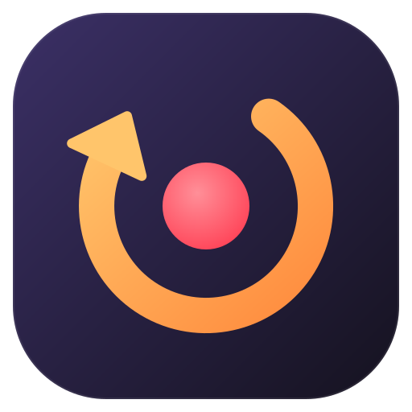
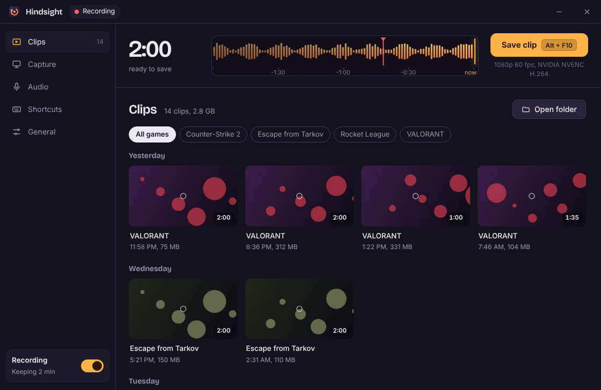
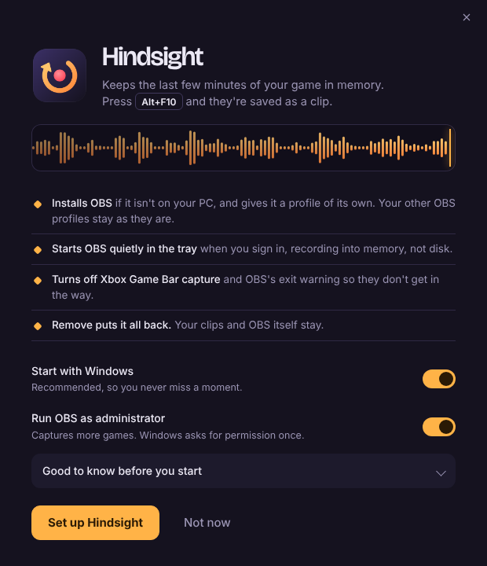
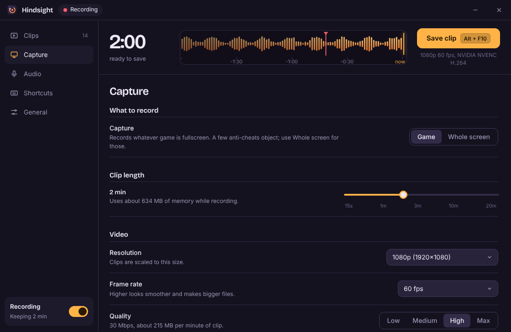

<p align="center"></p>

<h1 align="center">Hindsight</h1>

<p align="center">Instant replay for Windows, powered by OBS. It keeps the last few minutes of your game in memory, and one key saves them as a clip.</p>

<p align="center"></p>

## Install

Download **Hindsight.exe** from [Releases](https://github.com/RamenNuudlss/Hindsight/releases/latest), run it and press **Set up Hindsight**.

Or paste this into PowerShell:

```powershell
irm https://raw.githubusercontent.com/RamenNuudlss/Hindsight/main/install.ps1 | iex
```

Windows SmartScreen may warn you because the exe isn't code-signed. Choose **More info**, then **Run anyway**. Windows 10 or 11, 64-bit.

## Using it

| | |
|---|---|
| <kbd>Alt</kbd>+<kbd>F10</kbd> | Save the last 2 minutes (or whatever length you pick) |
| <kbd>Alt</kbd>+<kbd>X</kbd> | Open or close the Hindsight window |

- Clips land in `Videos\Clips`, sorted into a folder per game.
- The strip at the top of the window is your buffer: everything in it is what a save would keep. Red ticks mark clips you've saved.
- Click any clip to watch it, copy it (paste straight into Discord), show it in Explorer, or send it to the Recycle Bin.
- Everything else lives in the tray icon next to the clock: save a clip, pause recording, open the clips folder, or close the background OBS so you can stream with your own setup.

### Two ways to run OBS

- **Hindsight's own (default):** Hindsight runs a hidden OBS with its own profile and scenes. Good if you don't otherwise use OBS.
- **My OBS:** Hindsight clips from your OBS as it is. Your profile, scene collection and projectors stay put; Hindsight only turns on OBS's replay buffer and sets its length. Clips record OBS's main output (the scene that's live) with your own encoder and audio. Pick this if you stream, share a projector into Discord or TeamSpeak, or keep OBS open anyway. OBS may need one restart to turn on its replay buffer, and Hindsight switches on OBS's "save projectors on exit" so projectors come back after a restart.

Choose it during setup or any time under General > OBS setup.

### Settings

- **Capture:** game capture or a whole display, clip length (15 seconds to 20 minutes, with a live memory estimate), resolution, frame rate, quality and encoder (NVIDIA NVENC, AMD AMF, Intel Quick Sync or CPU, in H.264, HEVC or AV1 where your GPU supports it).
- **Audio:** game and desktop audio, microphone on or off, which mic, noise suppression, and optional separate audio tracks for editing.
- **Shortcuts:** change either hotkey; choose whether a sound and a corner notification confirm each save.
- **General:** clips folder, per-game folders, start with Windows, run OBS as administrator, and Remove.

<p align="center"> &nbsp; </p>

## What it changes on your PC

- Installs OBS Studio if you don't have it (through winget, or the official installer from OBS's GitHub).
- In **My OBS** mode: turns on the replay buffer in your current OBS profile, sets its length and memory limit, and turns on "save projectors on exit". Your recording path and everything else stay as they are.
- In Hindsight's own mode: adds its own OBS profile and scene collection, both named **Hindsight**. Your other profiles and scenes aren't touched, and OBS opens to your own setup again whenever Hindsight closes it.
- Turns on OBS's built-in websocket server so Hindsight can control OBS. If you already use it (Streamer.bot, Touch Portal and so on), your port and password are kept.
- Starts itself and OBS in the tray when you sign in. With **Run OBS as administrator**, that happens through a scheduled task, so Windows asks for permission once instead of every boot.
- Turns off Xbox Game Bar capture and OBS's "are you sure you want to exit" warning.
- Copies itself to `%LOCALAPPDATA%\Programs\Hindsight` and adds a Start menu shortcut and an Apps & features entry.

**Remove** (in General, or from Windows' Apps & features) puts every one of those back. Your clips and OBS itself stay.

## Good to know

- Game capture hooks into games, and some anti-cheats object to that. For Valorant, FACEIT, ESEA and similar, switch to **Whole screen** in Capture; it doesn't touch the game.
- Whole screen records everything on that display, so notifications and the Hindsight window can end up in clips.
- Your microphone is recorded by default. Turn it off in Audio.
- It doesn't get around DRM. Protected video shows up black in clips.
- If OBS crashes, Hindsight restarts it and skips OBS's safe-mode question, so a plugin that keeps crashing OBS won't get offered safe mode. After three crashes in a few minutes Hindsight stops and tells you.
- An outdated OBS plugin can make OBS show a plugin load error when it starts. Clicking OK is fine.
- Changing clip length or video settings restarts OBS, which empties the buffer.
- The window runs on Microsoft Edge WebView2, which comes with Windows 11 and most Windows 10 PCs. If it's missing, Hindsight offers to install it.

## Building from source

Hindsight is C# on .NET Framework 4.8 (built into Windows 10 and 11), with the interface in a single HTML file.

On Linux or WSL:

```bash
sudo apt install mono-devel binutils-mingw-w64-x86-64
./build.sh          # writes dist/Hindsight.exe
```

Open `ui/index.html` in a browser to work on the interface with sample data. Add `?mode=setup`, `?page=capture` or `?state=off` to see other screens.

Logs are in `%LOCALAPPDATA%\Hindsight\hindsight.log`. Creating an empty file named `devtools` in that folder turns on WebView2's developer tools.

## Credits

- [OBS Studio](https://obsproject.com) does all the capturing and encoding. Hindsight isn't affiliated with OBS or NVIDIA.
- [Microsoft Edge WebView2](https://developer.microsoft.com/microsoft-edge/webview2/) renders the interface. See [NOTICE.md](NOTICE.md).
- [Bricolage Grotesque](https://github.com/ateliertriay/bricolage) by Mathieu Triay, under the SIL Open Font License.
- The idea of a one-click OBS instant replay came from [ShadOBS](https://github.com/seandotnet/ShadOBS). Hindsight is written from scratch and shares no code with it.

## License

[MIT](LICENSE) © 2026 RamenNuudls
